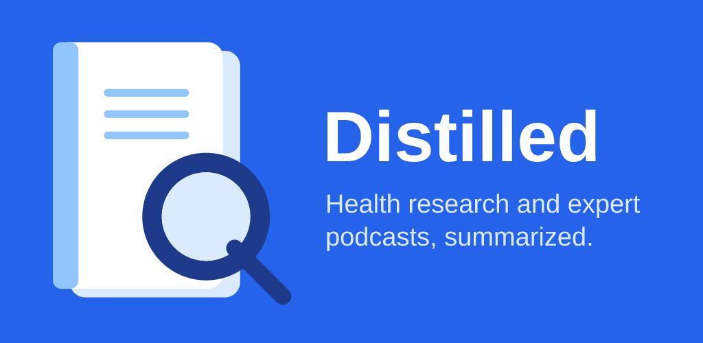
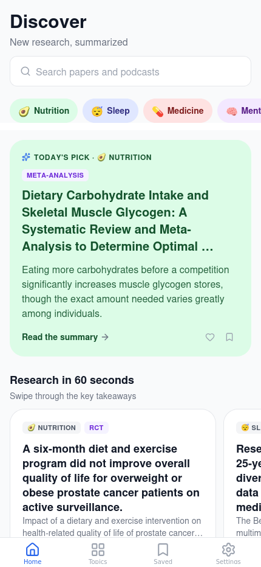
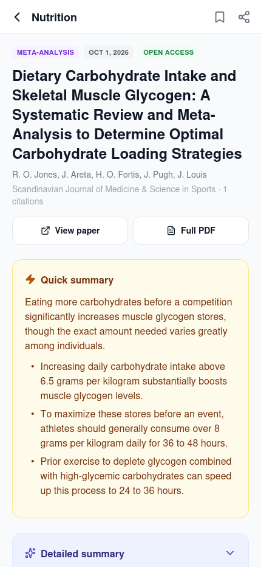
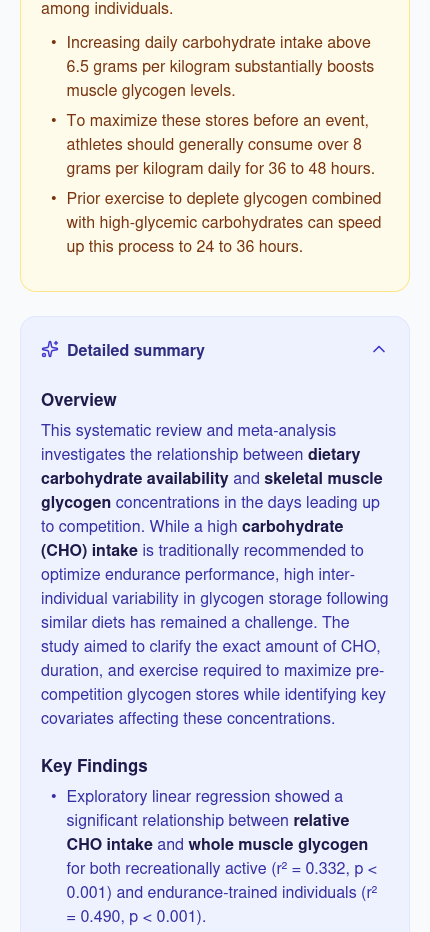
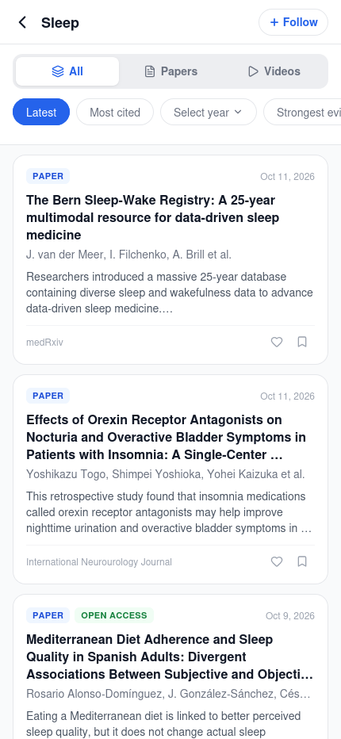
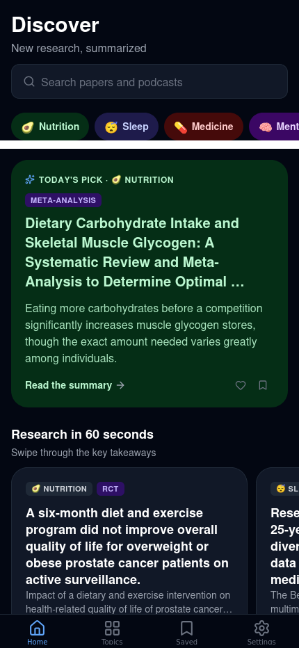
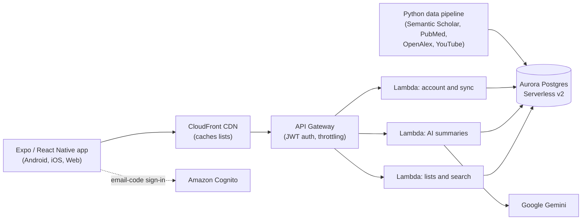

# Distilled

**Health research and expert podcasts, summarized in plain language.** Distilled collects the most-cited studies and expert conversations in 10 health topics (sleep, nutrition, exercise, mental health and more), ranks them by strength of evidence, and explains each one with an AI summary.

### Try it
- **Live web demo: [distilled.expo.app](https://distilled.expo.app)**. It's the same app as on Android, running in the browser against the production backend.
- **Android:** an APK will be on the [Releases](../../releases) page.

  
  
  
  
  

## Features
- **Daily home feed:** today's pick, swipeable "Research in 60 seconds" cards, strongest evidence, popular podcasts and trending papers.
- **Two AI summaries per paper:** a quick summary up front and a detailed one (overview, findings, methods, implications), next to the original abstract.
- **Evidence labels:** meta-analysis, systematic review, RCT and more, so users can tell strong studies from weak ones.
- **Search and filters:** full-text search across ~18,000 papers and curated podcasts, with filters by topic, year, study type and sort order.
- **Accounts:** passwordless email-code sign-in; saves, likes and followed topics sync across devices and work offline without an account.
- **Polish:** dark mode, screen-reader actions on cards, and in-app account deletion.

## Architecture

- **Serverless backend** defined as code (AWS SAM / CloudFormation): it costs almost nothing when idle and scales on demand.
- **Postgres full-text search** (`tsvector` + GIN index) instead of a separate search service.
- **CloudFront in front of the API:** repeat list loads drop from ~1.7 s to ~0.1 s, and cached hits never wake the auto-paused database.
- **Summaries generated server-side and cached:** the AI key never ships in the app, each paper is summarized once, and a paper with no abstract is never summarized from its title alone.
- **The summary Lambda runs outside the VPC:** it uses the RDS Data API and SSM over HTTPS, so no NAT gateway is needed.

## Engineering highlights
- **Cold starts:** the auto-paused database takes ~13 s to wake, so the first request after idle returned 500. Fixed end to end:
  - deadline-aware retries on the server (503 instead of 500)
  - retry with backoff in the app
  - the CDN never caches errors
- **AI input validation:** a fallback source sometimes returned a *different* paper's abstract, and the AI summarized it confidently. Abstracts are now stored only when the source title matches; an audit script found and removed 146 bad ones.
- **Account security:** found and fixed an account pre-hijacking risk in the passwordless sign-up flow. A Cognito trigger now replaces any user-chosen password and signs out all sessions.
- **AI reliability:** each Gemini call has its own timeout, with a reserved window for a fallback model, all inside API Gateway's 30 s limit. Concurrent requests for the same paper converge on one cached answer.
- **Offline-first sync:** device and account libraries merge on sign-in, and per-item rollback with version counters handles race conditions.
- **Pre-release bug hunt:** a multi-agent AI review, with finder and skeptic agents, surfaced 42 verified bugs across the app, API and data pipeline; all were fixed and deployed.

## Tech stack
- **App:** React Native 0.86, Expo SDK 57, TypeScript, NativeWind (Tailwind), React Navigation, EAS Build
- **Backend:** AWS Lambda (Node.js), API Gateway, Aurora Serverless v2 (PostgreSQL 17), CloudFront, Cognito, SSM, Secrets Manager, AWS SAM
- **AI:** Google Gemini (paper and video summaries)
- **Data:** Python pipeline over the Semantic Scholar, PubMed, OpenAlex and YouTube Data APIs

---
The source code is private; I'm happy to walk through it in an interview. Privacy policy: [jt-marte.github.io/distilled-site](https://jt-marte.github.io/distilled-site/).
